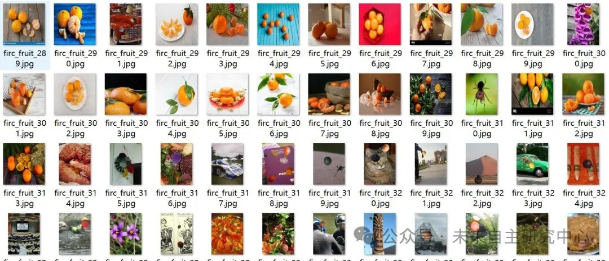
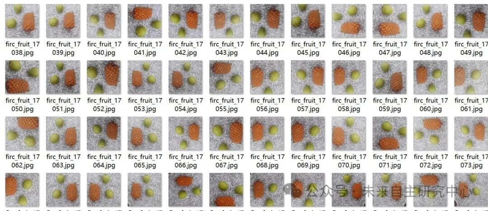
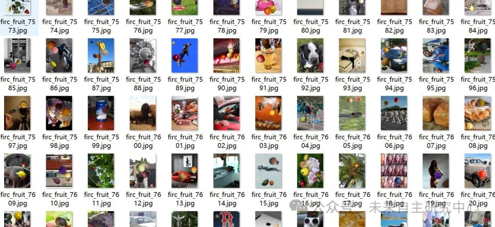
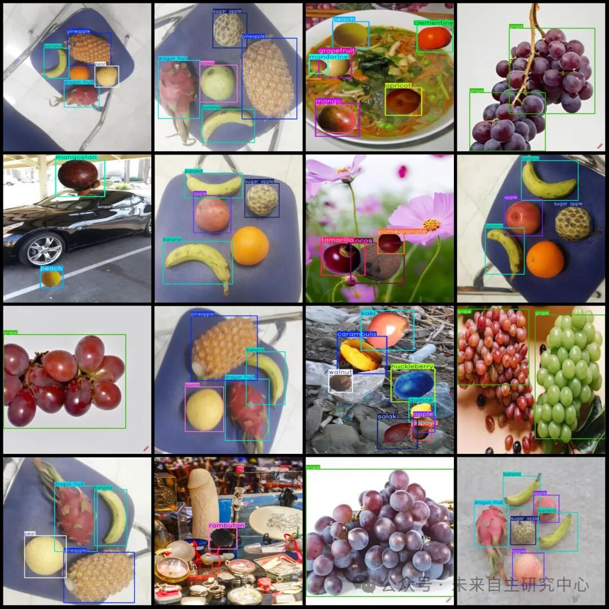

# Fruit Detection Multi-Class Fruit Detection Dataset with 13,374 Images and 67 Categories with Enhancements

The dataset contains enhanced images, approximately 6000 of which are paste enhancements, where fruits are randomly pasted onto the images to expand the dataset.

Dataset format: Pascal VOC format + YOLO format (txt file without split path, only containing jpg images and corresponding VOC format xml files and yolo format txt files)

Number of images (number of jpg files): 13374

Number of annotations (number of xml files): 13374

Number of annotations (number of txt files): 13374

Labeling category count: 67

Label category names (note that the order of yolo format categories does not correspond to this, but is based on the labels folder's classes.txt): ["apple", "apricot", "avocado", "banana", "beetroot", "blueberry", "cactus", "cantaloupe", "carambula", "cauliflower", "cherry", "chestnut", "clementine", "cocos", "cucumber", "dates", "dragon fruit", "eggplant", "ginger", "granadilla", "grape", "grapefruit", "guava", "hazelnut", "huckleberry", "kaki", "kiwi", "kohlrabi", "kumquats", "lemon", "limes", "lychee", "mandarine", "mango", "mangostan", "maracuja", "melon", "mulberry", "nectarine", "nut", "onion", "orange", "papaya", "passion", "peach", "pear", "pepino", "pepper", "physalis", "pineapple", "pitahaya", "plum", "pomegranate", "pomelo", "potato", "quince", "rambutan", "raspberry", "redcurrant", "salak", "strawberry", "sugar apple", "tamarillo", "tangelo", "tomato", "walnut", "watermelon"]

Number of boxes labeled in each category:

Apple Frames = 5449

Apricot Frame Count = 251

Avocado Frames = 294

banana Frames = 3774

Beetroot frame count = 296

Blueberry frame count = 236

Cactus frame count = 284

Cantaloupe frame count = 258

Carambula frame count = 238

Cauliflower frame count = 278

Cherry frame count = 254

Chestnut frame count = 255

clementine frame count = 254

cocos Frame Count = 246

Cucumber frame count = 134

Dates Frame Count = 249

Dragon fruit frame count = 1292

Eggplant frame count = 265

Ginger Frames = 287

Granadilla frame count = 270

Grape frame count = 5237

Grapefruit frame count = 264

Guava frame count = 1272

Hazelnut frame count = 261

Huckleberry frame count = 272

Kaki frame count = 281

Kiwi frame count = 293

Kohlrabi frame count = 266

Kumquats Frames = 285

Lemon frame count = 268

Number of limes = 271

Lychee frame count = 254

Mandarine frame count = 292

Mango Frames = 584

Mangostan frame count = 262

Maracuja frame count = 265

melon frame count = 276

Mulberry frame count = 260

Nectarine frame count = 276

Nut frame count = 265

Onion frame count = 285

Orange box count = 1513

Papaya frame count = 276

Passion Frames = 239

Peach frame count = 1207

Pear frame count = 517

pepino frame count = 266

Pepper frame count = 278

Phyllanthus Frames = 267

Pineapple frame count = 1090

Pitahaya Frames = 233

Plum Frames = 284

Pomegranate frame count = 262

Pomelo frame count = 243

Potato Frame Count = 256

Quince frame count = 267

Rambutan Frame Count = 266

Raspberry Frame Count = 229

Redcurrant frame count = 276

Salak Frames = 266

Strawberry frame count = 268

Sugar apple frame count = 1255

tamarillo frame count = 259

Tangelo Frame Count = 259

Tomato frame count = 736

Walnut frame count = 265

Watermelon frame count = 446

Total frame count: 38576

Using labelImg:

Annotation rules: Draw a rectangle around the category.

Important Notice: No

Special : This dataset does not guarantee the accuracy or precision of the trained models or weight files. The dataset is provided with accurate and reasonable annotations only.

Image Preview:

Annotation example:

## Payment

Here is a pay link on Stripe ( https://buy.stripe.com/3cs8yP7sY87d0vu9AB ). Please contact me lonlonago@foxmail.com after funding $89, and I will send you a complete data files , thank you!

